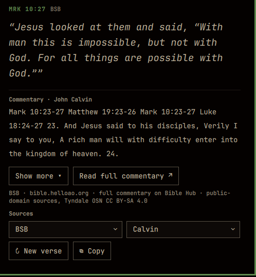

# Daily Verse



A daily Bible verse in the [Omarchy](https://omarchy.org) bar, with a
Reformed / Lutheran commentary. Click the bar icon to read the verse and its
commentary.

- Verse text: [Free Use Bible API](https://bible.helloao.org) (default BSB)
- Commentary preference: **Matthew Henry → Jamieson-Fausset-Brown → John Gill → John Calvin → Keil & Delitzsch → Tyndale Open Study Notes**
- Reformed / Lutheran / adjacent sources come first. **Tyndale Open Study Notes**
  (modern and broadly evangelical) sits at the end of the fallback chain and can
  also be chosen directly; it appears only when every source above it misses the
  verse. `adam-clarke` is never queried.

## Install

```sh
omarchy plugin add https://github.com/nautilusmare/omarchy-daily-verse.git --enable
```

## Use

- The bar shows a cross icon; hover it for the reference and verse text. Click to open the panel.
- Middle-click the bar icon, or press `↻ New verse`, for a new random verse.
- The **Sources** row holds two compact chips — translation and commentary — that pick sources directly. Choices persist.
- `⧉ Copy` copies `REF (Translation)\nverse text` to your clipboard via `wl-copy`.
- The panel shows a short commentary summary (cut at a sentence boundary, ~240 characters).
- `Show more ▾` opens the full commentary in a height-capped reading box (~300px) with its own slim scrollbar, so the panel grows by a fixed amount rather than by the length of the text. Clicking the text — or `Show less ▴` — collapses it back to the summary; the transition animates.
- `Read full commentary ↗` opens the chapter's commentary in your browser — [Bible Hub](https://biblehub.com) for the public-domain sources, and [STEPBible](https://www.stepbible.org) (its TNotes module) for Tyndale, which Bible Hub does not carry.
- When the panel itself overflows, a slim scrollbar appears on the right. Click the strip to jump, or drag the pill to scroll.
- `omarchy-shell shell summon maurice.daily-verse '{}'` opens the panel;
  `omarchy-shell shell hide maurice.daily-verse` closes it.

## Configure

Settings live in your `shell.json` layout entry, or you can just use the
dropdowns in the panel:

- `translation`: `BSB` (default), `eng_web` (World English Bible),
  `eng_kjv` (King James), `eng_gnv` (Geneva 1599, original spelling),
  `eng_asv` (American Standard), `eng_ylt` (Young's Literal).
- `commentary`: preferred source, one of `matthew-henry` (default),
  `jamieson-fausset-brown`, `john-gill`, `john-calvin`, `keil-delitzsch`,
  `tyndale`.
  The plugin automatically falls through the chain in that order when a verse
  has no entry (e.g. Calvin never wrote on Revelation). Tyndale is the last
  resort, so it only appears when the Reformed sources all miss.

## Develop locally

```sh
omarchy plugin validate ~/.config/omarchy/plugins/maurice.daily-verse
omarchy-shell shell rescanPlugins
```

Plugin code under `~/.config/omarchy/plugins/` hot-reloads on save.

## Remove

```sh
omarchy plugin remove maurice.daily-verse
```

## License

Plugin code is MIT — see [LICENSE](LICENSE).

Scripture text and commentary are fetched at runtime from the
[Free Use Bible API](https://bible.helloao.org) and carry their own terms:

- **Scripture translations** are public domain or freely licensed. The default,
  the Berean Standard Bible (BSB), is public domain.
- **Commentary** from Matthew Henry, Jamieson-Fausset-Brown, John Gill, John
  Calvin and Keil & Delitzsch is public domain.
- **Tyndale Open Study Notes** are © Tyndale House Publishers and licensed
  [CC BY-SA 4.0](https://creativecommons.org/licenses/by-sa/4.0/). Attribution
  is shown in the panel: *Tyndale OSN CC BY-SA 4.0*.

Nothing is bundled with this plugin; all text is requested per verse.
